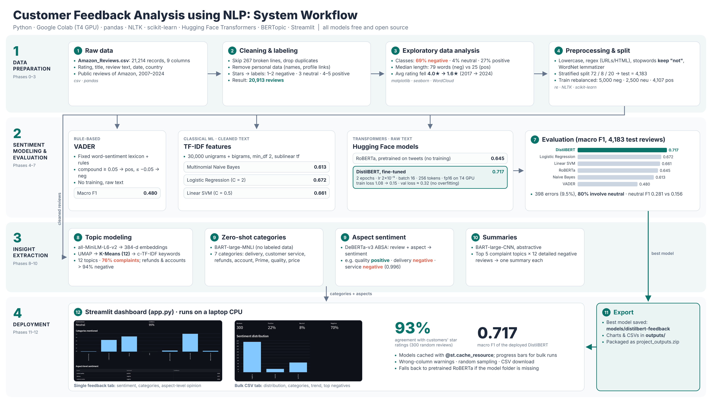
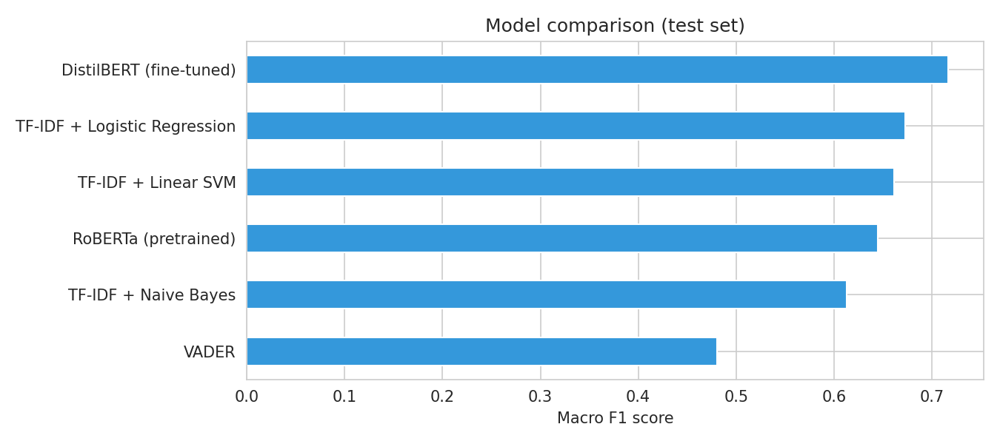
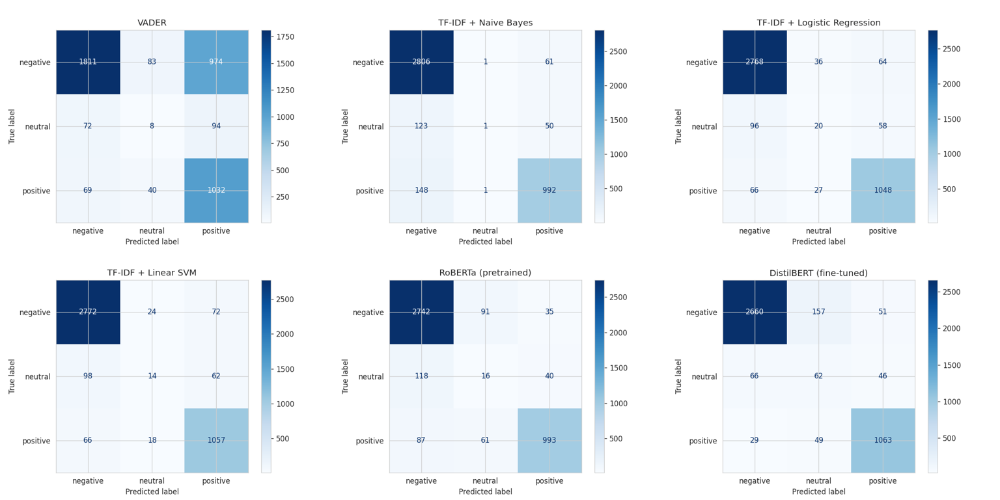
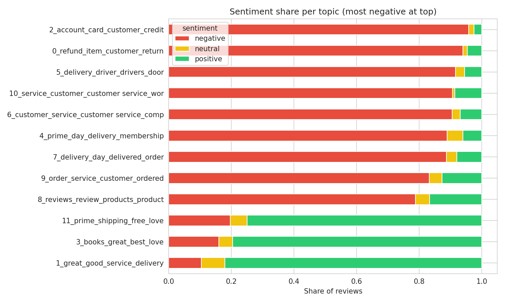
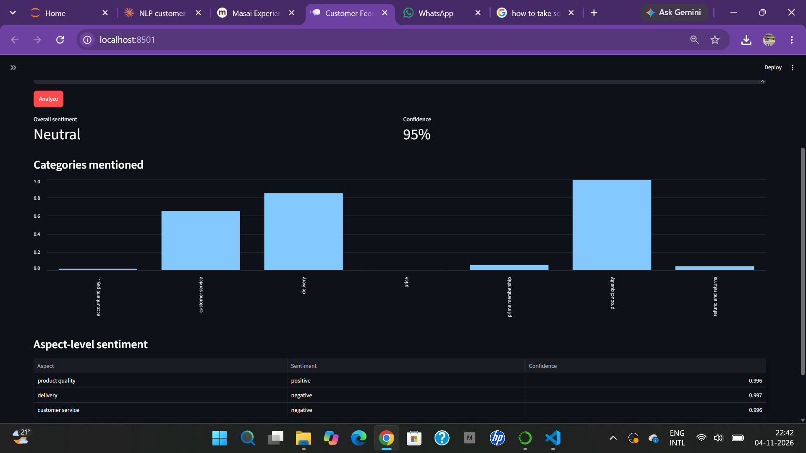
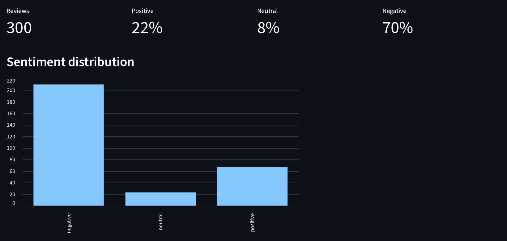

# Customer Feedback Analysis using NLP

An end-to-end Natural Language Processing project that reads customer reviews and tells a business **what customers feel** and **what they complain about**, built entirely with **free, open-source models**.



## Highlights

- **20,913 Amazon customer reviews** (2007–2024), labeled from star ratings: 69% negative, 4% neutral, 27% positive
- **6 sentiment models compared**, from a rule-based lexicon to a fine-tuned transformer
- **Best model: fine-tuned DistilBERT**, macro F1 **0.717**, accuracy 90.5%
- **12 complaint and praise topics** found with BERTopic; aspect-level sentiment with DeBERTa
- **Streamlit dashboard** for single reviews and bulk CSV files; predictions agreed with customers' star ratings for **93%** of 300 random reviews

## Results

| Model | Type | Accuracy | Macro F1 |
|---|---|---|---|
| **DistilBERT (fine-tuned)** | Transformer, trained on our data | 0.905 | **0.717** |
| TF-IDF + Logistic Regression | Classical ML | 0.917 | 0.672 |
| TF-IDF + Linear SVM | Classical ML | 0.919 | 0.661 |
| RoBERTa (pretrained, Twitter) | Transformer, no training | 0.897 | 0.645 |
| TF-IDF + Naive Bayes | Classical ML | 0.908 | 0.613 |
| VADER | Rule-based lexicon | 0.682 | 0.480 |

Evaluated on a held-out test set of 4,183 reviews. Macro F1 is the main metric because the data is imbalanced. Fine-tuned DistilBERT found 62 of the 174 neutral test reviews, three times more than any other model.

<p align="center"> </p>

### Key insights

- The average rating fell from **4.0★ (2016–17) to 1.6★ (2021–24)**.
- The most negative topics are **account and payment issues** and **refunds** (over 94% negative), followed by delivery drivers and customer service.
- Customers are mostly unhappy with the **service** around the products, not the products themselves.

<p align="center"></p>

## Dashboard

| Single feedback | Bulk CSV analysis |
|---|---|
|  |  |

The single-feedback tab shows overall sentiment, the business categories mentioned and the sentiment for each aspect. The bulk tab analyzes a CSV file and shows the sentiment distribution, sentiment by category, a trend over time and the most negative reviews.

## Pipeline

| Stage | Phases | What happens |
|---|---|---|
| 1. Data preparation | 0–3 | Load and clean the CSV, EDA, text preprocessing (keeping negations), stratified 72/8/20 split, training-set rebalancing |
| 2. Sentiment modeling | 4–6 | VADER; TF-IDF + Naive Bayes / Logistic Regression / Linear SVM; pretrained RoBERTa; fine-tuned DistilBERT |
| 3. Evaluation | 7 | Accuracy, macro precision/recall/F1, per-class F1, confusion matrices, error analysis |
| 4. Insight extraction | 8–10 | BERTopic (MiniLM embeddings + K-Means, 12 topics), zero-shot categories (BART-MNLI), aspect sentiment (DeBERTa-v3 ABSA), summaries (BART-CNN) |
| 5. Deployment | 11–12 | Export the model and outputs, Streamlit dashboard |

## Models used (all free on Hugging Face)

| Task | Model |
|---|---|
| Fine-tuned sentiment | `distilbert-base-uncased` |
| Pretrained sentiment | `cardiffnlp/twitter-roberta-base-sentiment-latest` |
| Sentence embeddings | `sentence-transformers/all-MiniLM-L6-v2` |
| Zero-shot categories | `facebook/bart-large-mnli` |
| Aspect sentiment | `yangheng/deberta-v3-base-absa-v1.1` |
| Summarization | `facebook/bart-large-cnn` |

## Repository structure

```
customer-feedback-nlp/
├── Customer_Feedback_NLP.ipynb   # full pipeline, Phases 0–11 (run on Google Colab)
├── app.py                        # Streamlit dashboard (Phase 12)
├── Amazon_Reviews.csv            # dataset (reviewer names and profile links removed)
├── requirements.txt
├── images/                       # charts and dashboard screenshots
└── report/                       # project report (PDF) and presentation (PPTX)
```

The trained model (`models/distilbert-feedback`, about 260 MB) is too large for the repository. Download it from [Releases](../../releases), or recreate it by running the notebook.

## How to run

You can either download the trained model (fastest) or train it yourself.

### Option A: Download the trained model (no training needed)

1. Go to the [Releases](../../releases) page of this repository.
2. Under the latest release (**v1.0**), download **`project_outputs.zip`**.
3. Unzip it into this project folder. It contains two folders:
   - `models/distilbert-feedback/`: the fine-tuned DistilBERT model
   - `outputs/`: all charts, model scores, topics and summaries
4. Check that `models/` and `outputs/` sit next to `app.py`, then go to **Run the dashboard** below.

### Option B: Train the models yourself (Google Colab, free GPU)

1. Open `Customer_Feedback_NLP.ipynb` in [Google Colab](https://colab.research.google.com).
2. Select **Runtime → Change runtime type → T4 GPU**.
3. Upload `Amazon_Reviews.csv`, then choose **Runtime → Run all** (about 40–60 minutes).
4. Download `project_outputs.zip` at the end and unzip it into this folder, so that `models/` and `outputs/` sit next to `app.py`.

### Run the dashboard (local machine)

```bash
python -m venv venv
venv\Scripts\activate          # Windows   (macOS/Linux: source venv/bin/activate)
pip install -r requirements.txt
streamlit run app.py
```

Then open http://localhost:8501. Without the `models/` folder, the app falls back to the pretrained RoBERTa model.

## Tech stack

Python · pandas · NumPy · NLTK · scikit-learn · vaderSentiment · PyTorch · Hugging Face Transformers · Sentence-Transformers · BERTopic · Matplotlib · seaborn · WordCloud · Streamlit · Google Colab

## Limitations and future work

- Only 4% of reviews are neutral, which limits performance on that class.
- Labels come from star ratings, which don't always match the review text.
- Future work: Hindi/Hinglish reviews (IndicBERT), sarcasm detection, real-time alerts, and a chatbot over the feedback.

## Team

| Member | Contribution |
|---|---|
| Neeraj Kumar | Data preparation, EDA, preprocessing, transformer fine-tuning |
| Kirtan Kumar | Classical ML models, evaluation, topic modeling and insights |
| Manas Kumar | Streamlit dashboard and testing |
| Mohit Kumar | Literature review, report and presentation |
